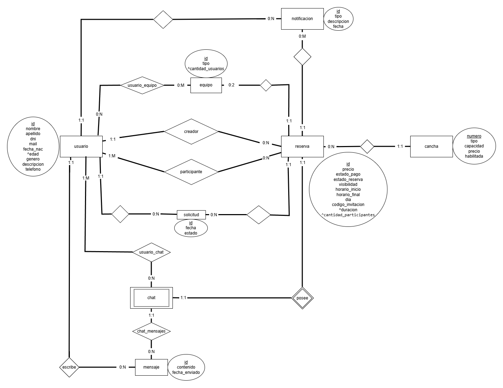

# Propuesta TP DSW

## Grupo
### Integrantes
* 54326 Doino, Roque
* 54689 Villa, Juan Pablo

### Repositorios
* Es un monorepo dentro de este mismo repositorio. La carpeta backend corresponde al backend. Lo mismo con la de front.

## Tema
### Descripción
*Doble Cinco es una aplicación para la gestión de un complejo de fútbol que permite a los usuarios reservar canchas. Además, proporciona la búsqueda de partidos, conectando jugadores sin equipo con otros usuarios o equipos completos.*

### Modelo

## Alcance Funcional 

### Alcance Mínimo

Regularidad:
|Req|Detalle|
|:-|:-|
|CRUD simple|1. CRUD Usuario 2. CRUD Cancha |
|CRUD dependiente|1. CRUD Equipo {depende de} Reserva |
|Listado + detalle| 1. Listado de canchas filtrado por tipo y disponibilidad para una fecha y horario. Muestra número, tipo, capacidad y precio → detalle CRUD Cancha. |
|CUU/Epic|1. Generar una Reserva de cancha para un partido. |

Adicionales para Aprobación
|Req|Detalle|
|:-|:-|
|CRUD |1. CRUD Usuario 2. CRUD Cancha 3. CRUD Equipo |
|CUU/Epic|1. Generar una reserva de cancha para un partido. 2. Gestionar la incorporación a una reserva pública o privada mediante solicitudes: solicitar unirse, notificar al creador y aceptar o rechazar la solicitud. |

### Alcance Adicional Voluntario

*Nota*: El Alcance Adicional Voluntario es opcional, pero ayuda a que la funcionalidad del sistema esté completa y será considerado en la nota en función de su complejidad y esfuerzo.

|Req|Detalle|
|:-|:-|
|Listados |1.Listado de reservas públicas con cupo disponible, filtrado por fecha y tipo de cancha. Muestra día, horario, cancha, precio y cantidad de participantes → detalle de la reserva. 2.Listado de reservas de un usuario, filtrado por fecha y estado → detalle de la reserva.|
|CUU/Epic|1. Modificación de reserva.   2. Cancelación de reserva.   3. Abandonar una reserva como participante.   4. Moderación del chat.   5. Regeneración del enlace de invitación.|
|Otros|1. Chat exclusivo para los participantes de cada reserva. 2. Envío de recordatorios de reserva por email. |

